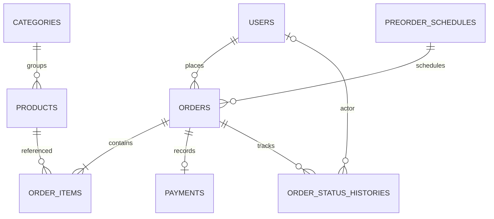

# Database Final

Migrasi adalah sumber kebenaran. Snapshot SQL: `database/mealorder-final.sql`. Seeder hanya berjalan pada local/testing. 8 tabel bisnis, ditambah tabel framework untuk cache, jobs, session, reset password dan token Sanctum.

## Data dictionary (PK id BIGINT UNSIGNED; FK juga BIGINT UNSIGNED)
| Table | Fields | Meaning |
|---|---|---|
| users | name varchar100, email varchar150 unique, password varchar255, role enum customer/admin, phone varchar20 nullable, email_verified_at, remember_token, timestamps | akun dan otorisasi; hash password |
| categories | name varchar100 unique, description text nullable, timestamps | kategori |
| products | category_id FK restrict, name varchar150, description, price decimal(12,2), stock uint, image varchar255, is_available boolean, timestamps | katalog dan stok |
| preorder_schedules | title varchar150, start_at, end_at, fulfillment_at nullable datetime, quota uint, status draft/open/closed, timestamps | periode PO dan waktu fulfillment |
| orders | user_id, schedule_id FK restrict, order_code unique, total_amount decimal(12,2), status varchar30, notes, fulfillment pickup/delivery, delivery_address, contact_phone, delivery_fee decimal(12,2), cancellation_reason, timestamps | transaksi dan ongkir snapshot |
| order_items | order_id, product_id FK restrict, product_name snapshot, price decimal(12,2), quantity uint, subtotal decimal(12,2) | harga dan nama saat transaksi |
| payments | order_id unique FK, method varchar50, amount decimal(12,2), status unpaid/waiting_confirmation/paid/rejected, paid_at | pembayaran manual |
| order_status_histories | order_id FK restrict, actor_id nullable FK set null, status, reason, created_at | jejak transisi baru |

Pesanan lama tetap ada; riwayat sebelum upgrade tidak direkonstruksi. Waktu disimpan dalam konfigurasi waktu aplikasi (default UTC) dan ditampilkan menurut zona browser. Desain relasional memisahkan entitas; snapshot nama/harga/total sengaja didenormalisasi untuk histori. Penghapusan kategori/menu yang direferensikan ditolak. Checkout dan perubahan status memakai transaksi dan lock; kuota dihitung dari porsi non-cancelled. Ongkir tetap dari konfigurasi, bukan input user. Laporan memakai waktu penyelesaian `updated_at` dan status selesai + lunas. Nilai termasuk ongkir.

## Tambahan Final
`products.deleted_at` nullable untuk arsip produk yang sudah dipesan. `order_items.product_image` varchar(255) nullable: snapshot path foto saat checkout. `products.image`: path relatif `meal-images/uuid.jpg` atau `images/menu/...`; tidak boleh diatur langsung oleh klien. Riwayat tidak bergantung pada nama/harga/foto produk saat ini. `ready` dipakai untuk status siap; delivery default nonaktif.
